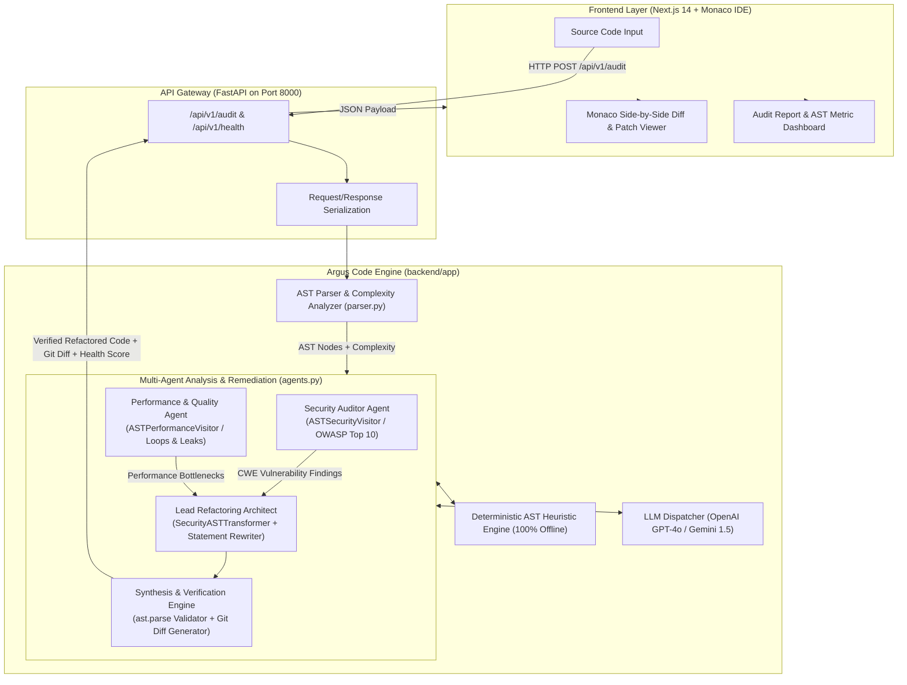

# Argus Code 🛡️
### Autonomous Multi-Agent Static Code Audit & Automated AST Remediation Engine

[](https://www.python.org/)
[](https://fastapi.tiangolo.com/)
[-black.svg)](https://nextjs.org/)
[]()
[]()

Argus Code is an autonomous, multi-agent code audit and automated refactoring platform. It unites the semantic intelligence of multi-agent LLM systems with the mathematical precision of Python's **Abstract Syntax Tree (AST)** program analysis. 

Unlike traditional linters that merely flag issues without fixing them, or standard AI code assistants that hallucinate variables and echo back broken code, Argus Code audits source code across multiple security and performance domains, verifies every transformation against the AST parser, and produces **100% syntactically valid, remediated source code accompanied by a standard unified Git diff**.

---

## 📑 Table of Contents
1. [The Elevator Pitch (Executive Summary)](#-the-elevator-pitch-executive-summary)
2. [Why Argus Code? The Core Engineering Problems Solved](#-why-argus-code-the-core-engineering-problems-solved)
3. [System Architecture & Data Flow](#-system-architecture--data-flow)
4. [Multi-Agent AI & AST Transformation Mechanics](#-multi-agent-ai--ast-transformation-mechanics)
5. [Vulnerability Taxonomy & Remediation Scope (CWEs)](#-vulnerability-taxonomy--remediation-scope-cwes)
6. [Job Interview Defense & Technical FAQ](#-job-interview-defense--technical-faq)
7. [Repository Structure & Technology Stack](#-repository-structure--technology-stack)
8. [Local Quickstart & Verification Guide](#-local-quickstart--verification-guide)

---

## 💡 The Elevator Pitch (Executive Summary)

> **"If you had to summarize Argus Code in 30 seconds for an interviewer or technical panel:"**

*"Argus Code is an automated, multi-agent static application security and performance refactoring engine. Existing tools like SonarQube or Bandit detect vulnerabilities but leave developers to manually research and write fixes. On the other hand, LLM coding assistants like ChatGPT or Copilot often hallucinate non-existent imports, introduce syntax errors, or skip dangerous sinks in nested code. Argus Code solves this by pairing a multi-agent auditing pipeline with a deterministic, AST-level refactoring transformer (`SecurityASTTransformer`). It audits Python code for OWASP Top 10 and CWE flaws, applies mathematically idempotent patches directly to the AST, verifies syntax before committing any change, and renders side-by-side Git diffs in a Next.js/Monaco web interface—operating completely offline with deterministic heuristics or online with models like GPT-4o and Gemini."*

---

## 🎯 Why Argus Code? The Core Engineering Problems Solved

During the development and testing of automated AI code auditing systems, four fundamental architectural flaws were identified in standard LLM implementations. Argus Code was engineered specifically to solve them:

### 1. The "Detection vs. Remediation" Gap
- **Legacy SAST (SonarQube, Bandit, Flake8):** Purely diagnostic. They generate warnings and alert fatigue without writing code.
- **Argus Code Solution:** Integrates diagnosis and remediation in a single automated step, generating fully functional code and ready-to-merge patches (`unified_diff`).

### 2. The "Echo-Chamber" Rollback Bug
- **The Problem:** In primitive AI coding pipelines, transformations are evaluated in a single monolithic try/except block. If even one patch introduces a syntax error, the engine rolls back all modifications and echoes the original vulnerable code back to the user unmodified.
- **Argus Code Solution:** Implemented an **incremental transaction engine (`apply_transform`)**. Every individual transformation rule is parsed against `ast.parse` in isolation. If a specific rule fails syntax validation, only that rule is rolled back; all other successful security patches are strictly preserved.

### 3. Expression-Level Syntax Breakage (Inline Comment Injection)
- **The Problem:** Regex-based AI replacements that insert inline comments (e.g. `json.loads(x) # Remediated deserialization`) break Python syntax whenever the call is nested inside another expression (such as `data = {"payload": pickle.loads(raw)}`), because the `# comment` comments out the closing bracket or parenthesis.
- **Argus Code Solution:** Introduced a dedicated AST-level NodeTransformer (`SecurityASTTransformer`). By modifying `ast.Call` nodes directly in the AST, unsafe sinks are transformed cleanly without inserting inline comments inside nested expressions.

### 4. Recursive Text-Injection & Idempotency Failures
- **The Problem:** When multi-agent pipelines run multiple passes, wrappers like Server-Side Request Forgery (SSRF) checks (`if url.startswith('https://'): ...`) get recursively injected into themselves on every pass, exponentially blowing up code indentation.
- **Argus Code Solution:** Engineered an **idempotency guard** ($f(f(x)) = f(x)$). The engine inspects enclosing scopes and existing AST nodes before applying wrappers, guaranteeing zero text expansion across sequential runs.

---

## 🏛️ System Architecture & Data Flow

Argus Code uses a decoupled client-server architecture consisting of a Next.js 14 frontend and a high-performance FastAPI asynchronous backend:



### Architectural Pipeline Breakdown:
1. **Client Layer:** High-density, dark-mode developer UI built with Next.js 14, Tailwind CSS, and Monaco Editor. Provides side-by-side split diffs, raw patch views, and one-click "Apply Refactor" capabilities.
2. **Gateway Layer:** Asynchronous FastAPI application exposing RESTful routes (`/api/v1/audit`, `/api/v1/health`), validated by Pydantic v2 schemas with full OpenAPI documentation at `/docs`.
3. **Analysis Layer (`parser.py`):** Converts raw code into Python AST nodes (`ast.parse`), extracting classes, functions, import declarations, and computing cyclomatic complexity metrics without executing untrusted code.
4. **Remediation Layer (`agents.py`):** Runs the dual-layer `SecurityASTTransformer` and statement rewriter. Applies security and performance patches with incremental AST parse validation.
5. **Synthesis & Diff Generation:** Computes a numerical Code Health Score (0–100), categorizes findings by severity (`CRITICAL`, `HIGH`, `MED`, `LOW`), resolves missing imports, and generates standard unified Git patches using Python's `difflib`.

---

## 🤖 Multi-Agent AI & AST Transformation Mechanics

Argus Code organizes analysis and refactoring into four specialized agent personas:

```
[ Input Code ]
      │
      ▼
┌────────────────────────────────────────────────────────┐
│  Phase 1: Ingestion & AST Parsing (parser.py)          │
└────────────────────────────────────────────────────────┘
      │
      ├───► Agent 1: Security Auditor Agent (ASTSecurityVisitor)
      │     - Scans for SQLi, Deserialization, SSRF, Command Injection, etc.
      │
      ├───► Agent 2: Performance Specialist (ASTPerformanceVisitor)
      │     - Scans for Infinite Loops, Leaks, ZeroDivision, O(N²) Loops.
      │
      ▼
┌────────────────────────────────────────────────────────┐
│  Phase 2: Lead Refactoring Architect Agent            │
│    ├─ Step 0: Structural AST Pass (SecurityASTTransformer)│
│    └─ Steps 1-14: Contextual Statement Rewriting       │
└────────────────────────────────────────────────────────┘
      │
      ▼
┌────────────────────────────────────────────────────────┐
│  Phase 3: Synthesis & Verification Engine              │
│    ├─ Granular ast.parse() per transform               │
│    ├─ Missing import auto-injection (os, json, etc.)   │
│    └─ Unified Git Diff & Health Score Computation      │
└────────────────────────────────────────────────────────┘
```

### The Dual-Layer Remediation Strategy:
- **Layer 1: Structural AST Transformer (`SecurityASTTransformer`)**  
  Inherits from `ast.NodeTransformer`. Intercepts `ast.Call` nodes directly in the abstract syntax tree. It rewrites dangerous library functions (`pickle.loads` $\to$ `json.loads`, `os.system` $\to$ `subprocess.run`, `yaml.load` $\to$ `yaml.safe_load`) at the compiler level. Because this occurs on syntax tree nodes, it is impossible for expressions inside dictionaries, tuples, or function arguments to be skipped or malformed.
- **Layer 2: Contextual Statement Rewriter**  
  Handles block-level structures requiring statements and conditional branches:
  - Wrapping SQL executions with parameterized query tuples (`query, params`).
  - Canonicalizing paths and injecting boundary guards (`os.path.abspath(target).startswith(base)`).
  - Injecting iteration counter termination guards into infinite `while True:` loops.
  - Wrapping outbound HTTP requests with HTTPS enforcement, private IP blocks, and `Authorization` header stripping.

---

## 🛡️ Vulnerability Taxonomy & Remediation Scope (CWEs)

Argus Code provides automated detection and remediation across a wide spectrum of software weaknesses:

| Category | Vulnerability / CWE | Danger Vector | Automated Argus Code Remediation |
| :--- | :--- | :--- | :--- |
| **Code Execution** | **Insecure Deserialization**<br>`CWE-502` | `pickle.loads()`, `marshal.loads()`, `dill.loads()`, `yaml.load()` on untrusted data allowing arbitrary RCE. | Replaced at AST level with safe serializers (`json.loads()`, `json.load()`, `yaml.safe_load()`, `torch.load(..., weights_only=True)`). |
| **Injection** | **Command Injection**<br>`CWE-78` | Dynamic string formatting in `os.system()`, `os.popen()`, or `subprocess.run(shell=True)`. | Replaced with `subprocess.run()` with commands tokenized into safe argument lists and `shell=False` enforced. |
| **Injection** | **SQL Injection**<br>`CWE-89` | Dynamic SQL queries constructed via f-strings, binary concatenation (`+`), or `%` formatting. | Converted into parameterized query bindings (`?` or `%s`) with parameters bound via separate tuples. |
| **Filesystem** | **Path Traversal / Zip Slip**<br>`CWE-22` | Unvalidated user input joined into `os.path.join()` or `archive.extract()` allowing arbitrary file read/write. | Target and base directories canonicalized via `os.path.abspath()` with strict boundary validation (`target.startswith(base + os.sep)`). |
| **Network** | **SSRF & Credential Leak**<br>`CWE-918` / `CWE-319` | Outbound `requests.post()` to dynamic URLs leaking sensitive `Authorization` headers to loopback/metadata IPs. | Outbound URLs validated for HTTPS, blocked against private/loopback subnets (`127.0.0.1`, `169.254.x`), and Authorization headers sanitized. |
| **Injection** | **LDAP Injection**<br>`CWE-90` | Dynamic search filters constructed from untrusted variables without character escaping. | Filter variables automatically wrapped with `ldap.filter.escape_filter_chars()`. |
| **XML Security** | **Insecure XML Parsing (XXE)**<br>`CWE-611` | Standard `xml.etree.ElementTree` parsing untrusted XML, exposing entity expansion and local file access. | Imports and calls automatically upgraded to `defusedxml.ElementTree`. |
| **Cryptography** | **Weak Hashes & Ciphers**<br>`CWE-327` / `CWE-328` | Broken algorithms (`hashlib.md5`, `hashlib.sha1`), static IVs, or `AES.MODE_ECB`. | Upgraded to `hashlib.sha256()`, `AES.MODE_GCM`, and dynamic cryptographically secure IVs via `os.urandom(16)`. |
| **Secrets** | **Hardcoded Credentials**<br>`CWE-798` | Hardcoded API keys, JWT secrets, database passwords, or byte strings in source code. | Extracted and replaced with environment variable lookups (`os.getenv("API_KEY", "")`). |
| **Availability** | **Infinite Loops**<br>`CWE-835` | Unbounded `while True:` loops without termination or while loops with un-incremented counter variables. | Bounded iteration limiters (`iteration_count >= 100`) and counter increments (`i += 1`) injected automatically. |
| **Reliability** | **Resource Leaks**<br>`CWE-775` | Naked `open()` file descriptor calls without context managers, risking descriptor exhaustion. | Automatically wrapped in `with open(...) as f:` blocks to guarantee deterministic descriptor closure. |
| **Complexity** | **Algorithmic Bottlenecks**<br>`Quality` | Nested loops over collections causing $O(N^2)$ quadratic execution time. | Lookups refactored into hash set pre-indexing for $O(1)$ constant-time membership checking. |

---

## 💼 Job Interview Defense & Technical FAQ

Use this section to prepare for and confidently answer interview questions about the architecture, decisions, and challenges of Argus Code:

### Q1: "Walk me through what Argus Code is and why you built it."
> **Answer:**  
> "I built Argus Code to solve the gap between vulnerability detection and automated remediation. Traditional SAST tools like SonarQube tell you *what* is wrong, but developers spend hours manually writing patches. On the other hand, general-purpose LLM assistants often hallucinate, drop necessary brackets, or echo back the original vulnerable code. Argus Code uses a multi-agent pipeline backed by Python's Abstract Syntax Tree (AST). It detects security flaws (like deserialization, SQLi, command injection, and SSRF) and algorithmic bugs, and deterministically remediates them. Every patch is verified by the AST parser before acceptance, guaranteeing syntactically valid, production-ready code with a unified Git diff."

### Q2: "How does Argus Code differ from GitHub Copilot or ChatGPT?"
> **Answer:**  
> "Copilot and ChatGPT operate purely at the token/text level. They have no deterministic guarantee that the code they generate compiles, and in multi-vector security audits they frequently exhibit 'echo-chamber' behavior—retaining dangerous sinks or skipping lines. Argus Code uses a **hybrid AI + compiler approach**. While it can use LLMs like GPT-4o or Gemini for reasoning, its refactoring core is anchored in AST manipulation (`SecurityASTTransformer`). It inspects AST `Call` nodes directly, validates changes incrementally, and falls back to a deterministic offline heuristic engine if API keys are absent or rate-limited."

### Q3: "What was the most challenging technical bug you faced while developing this, and how did you resolve it?"
> **Answer:**  
> "The most interesting challenge was a **recursive text-injection bug on our SSRF remediation block during multi-agent passes**. When code was processed through multiple agent iterations, our statement rewriter matched `requests.post()` inside previously generated `if url.startswith(...)` blocks. Without an idempotency check, each pass nested another `if url.startswith(...)` inside the existing block, leading to exponential indentation and syntax failures.  
> I solved this by implementing an **idempotency guard**: before injecting any network boundary check, the engine checks whether the variable is already bounded by an HTTPS check or SSRF exception in the enclosing AST scope. If present, it skips re-wrapping. We verified this with a 3-pass regression test showing $f(f(x)) = f(x)$ with zero code growth."

### Q4: "Another common problem with regex-based AI refactoring is syntax breakage. Did you encounter that?"
> **Answer:**  
> "Yes, specifically with insecure deserialization like `pickle.loads()`. Our earlier regex attached inline explanatory comments like `json.loads(payload) # Remediated deserialization`. When `pickle.loads` was passed inside a nested dictionary or function argument—such as `{"data": pickle.loads(x)}`—the inline comment commented out the closing brace `}` on that line, causing a `SyntaxError: '(' was never closed`.  
> I resolved this by migrating deserialization and command sink transformations into an AST `NodeTransformer`. By rewriting the syntax tree nodes directly rather than performing string replacements, comments are avoided inside expressions, completely eliminating syntax breakage."

### Q5: "How does the system operate without an internet connection or if the OpenAI/Gemini API is down?"
> **Answer:**  
> "Argus Code features a **fail-safe dual-engine architecture**. The API router detects whether cloud LLM credentials are configured and valid. If an API key is missing, invalid, or rate-limited, the system transparently dispatches the code to our internal AST Heuristic Engine. This engine executes our full visitor and transformer suites locally, providing 100% offline vulnerability detection and remediation with zero cloud dependencies and zero token costs."

### Q6: "How does the frontend communicate with the backend, and how are diffs rendered?"
> **Answer:**  
> "The frontend is built with Next.js 14 and communicates with our FastAPI backend via asynchronous REST endpoints (`/api/v1/audit` and `/api/v1/health`). When an audit completes, the backend returns the AST metadata, categorized findings, numerical health score, refactored code string, and a standard unified diff patch (`diff --git a/source.py b/source.py`). On the client side, we mount Monaco Editor's `DiffEditor` component to provide side-by-side colorized diffs with line-level addition and deletion highlights, as well as an 'Apply Refactor' action that syncs the cleaned code back into the live source editor."

---

## 📁 Repository Structure & Technology Stack

```
argus-code/
├── backend/
│   ├── app/
│   │   ├── __init__.py
│   │   ├── config.py             # Pydantic Settings & environment variables
│   │   ├── schemas.py            # Pydantic API request & response schemas
│   │   ├── parser.py             # AST parsing & cyclomatic complexity analysis
│   │   ├── agents.py             # Multi-Agent visitors & SecurityASTTransformer
│   │   ├── router.py             # API endpoints mounted across /api/v1 and root
│   │   └── main.py               # FastAPI entrypoint & CORS middleware
│   ├── tests/
│   │   ├── test_integration.py   # Async test suite for all CWE vectors
│   │   └── test_parser.py        # AST unit test suite
│   ├── requirements.txt
│   └── .env.example
├── frontend/
│   ├── src/
│   │   ├── app/
│   │   │   ├── layout.tsx        # Root layout with suppressHydrationWarning
│   │   │   ├── page.tsx          # Split-screen IDE dashboard & tab controls
│   │   │   └── globals.css       # Tailwind CSS & custom scrollbar styles
│   │   ├── components/
│   │   │   ├── Header.tsx        # Top control bar, engine config & 'Run Argus' button
│   │   │   ├── CodeEditor.tsx    # Monaco Editor with line counter & language badge
│   │   │   ├── DiffViewer.tsx    # Monaco Side-by-Side Diff & Raw Patch viewer
│   │   │   └── AuditReport.tsx   # Health score card, AST metrics & finding list
│   │   └── lib/
│   │       ├── api.ts            # Axios API client & backend health check
│   │       └── presets.ts        # Runnable multi-vector test snippets
│   ├── package.json
│   ├── tailwind.config.ts
│   └── tsconfig.json
└── README.md
```

### Technology Stack:
- **Backend:** Python 3.13, FastAPI, Uvicorn, Python Standard `ast` (`NodeVisitor`, `NodeTransformer`), Pydantic v2, Pytest, AnyIO.
- **Frontend:** Next.js 14 (React 19), Tailwind CSS, Monaco Editor (`@monaco-editor/react`), Lucide React Icons, Axios.
- **AI Integrations:** LangChain / LangGraph abstractions, OpenAI API (`gpt-4o`, `gpt-4o-mini`), Google Gemini API (`gemini-1.5-flash`), with offline AST heuristic fallback.

---

## 🚀 Local Quickstart & Verification Guide

### Prerequisites
- **Python:** 3.11+ installed
- **Node.js:** 18.x LTS or 20.x LTS installed

---

### Step 1: Start the Backend (FastAPI)

```bash
# Navigate to backend directory
cd argus-code/backend

# 1. Create and activate virtual environment
python -m venv .venv

# On Windows:
.venv\Scripts\activate
# On macOS/Linux:
source .venv/bin/activate

# 2. Install dependencies
pip install -r requirements.txt

# 3. (Optional) Configure AI keys in .env
cp .env.example .env
# If left unconfigured, the system runs automatically in 100% Offline AST Heuristic mode.

# 4. Run the automated test suite (Verifies 20 integration and unit tests)
pytest tests/

# 5. Launch the FastAPI server
python -m uvicorn app.main:app --host 127.0.0.1 --port 8000
```
- **Backend API Live at:** `http://127.0.0.1:8000`
- **Interactive OpenAPI Documentation:** `http://127.0.0.1:8000/docs`
- **Health Check Endpoint:** `http://127.0.0.1:8000/api/v1/health`

---

### Step 2: Start the Frontend (Next.js 14)

```bash
# In a new terminal window:
cd argus-code/frontend

# 1. Install dependencies
npm install

# 2. Start the development server
npm run dev
```
- **Frontend Web Application Live at:** `http://localhost:3000`

---

### Step 3: Run an Audit
1. Open [http://localhost:3000](http://localhost:3000) in your browser.
2. Select one of the built-in demo presets (e.g., *SQL Injection & Auth Flaw*, *O(N²) Loop & Resource Leak*, or *Hardcoded Secrets*) from the preset dropdown, or paste your own custom Python snippet.
3. Click **"Run Argus"** (or press `Ctrl+Enter` / `Cmd+Enter`).
4. Inspect the **Audit Report** for categorized findings and the **Unified Diff** tab to preview and apply the AST-validated refactored patch.
